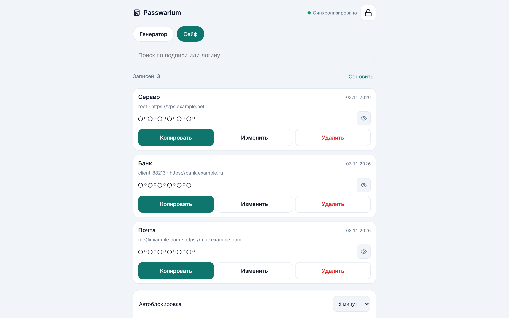
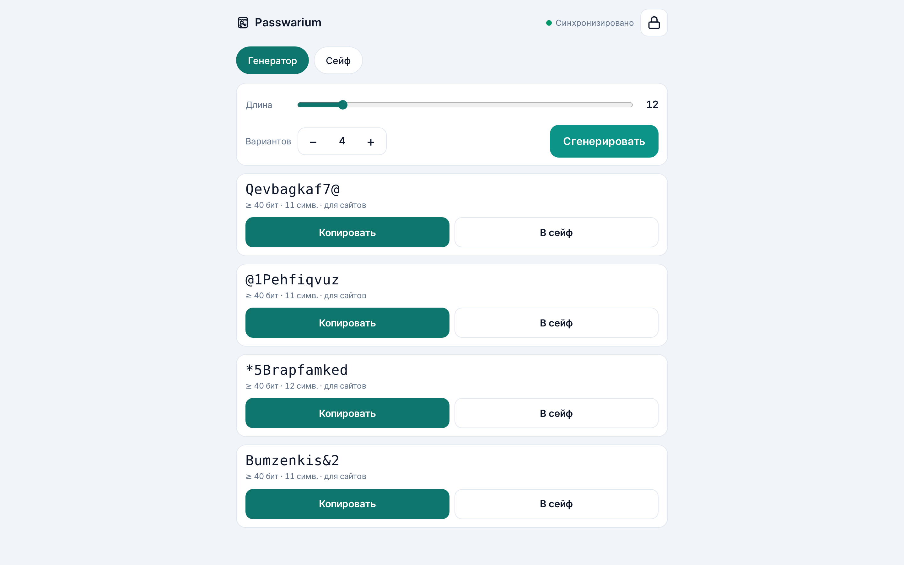
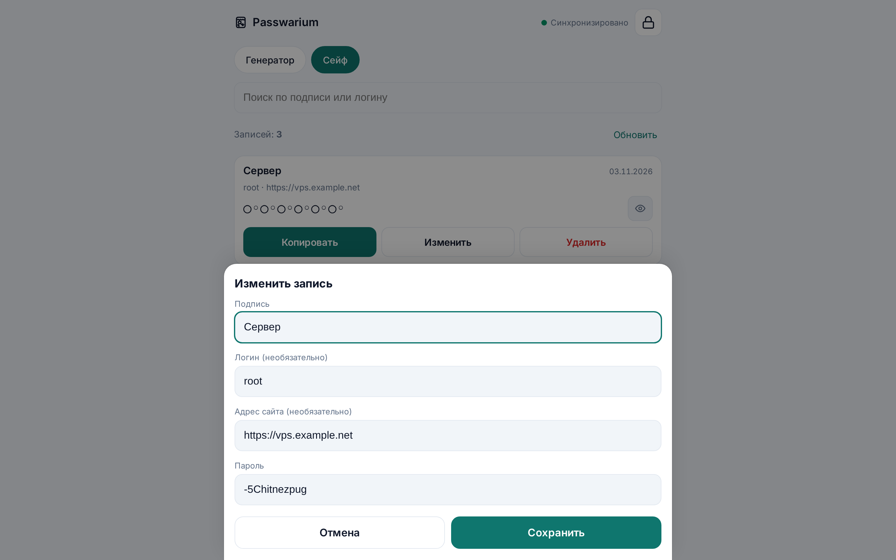
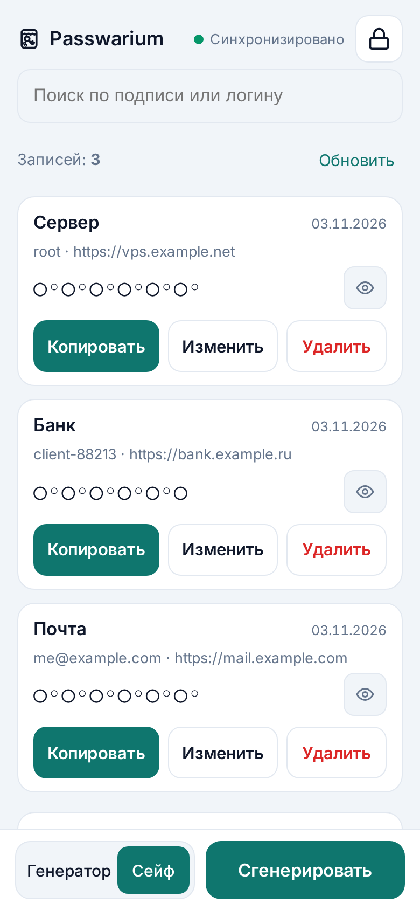
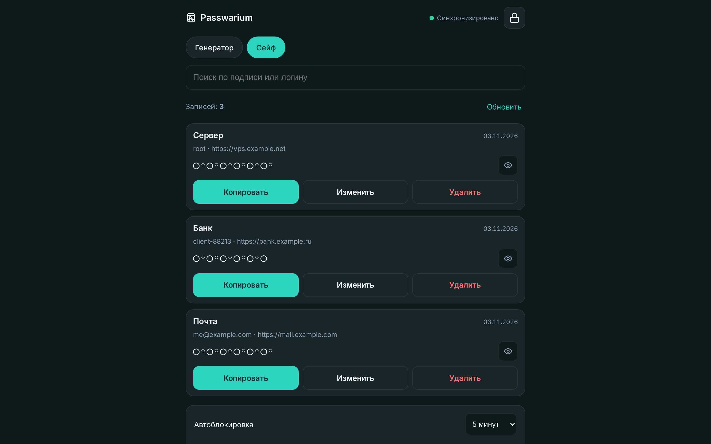

# Passwarium

**Стекло снаружи. Ключ — у вас.**

[🇬🇧 English](README.en.md) · [Политика безопасности](SECURITY.md) · [MIT](LICENSE)

[](LICENSE)
[](https://github.com/s4ps4n/passwarium/actions/workflows/tests.yml)
[](https://www.python.org/)
[](#как-это-устроено)
[](#как-это-устроено)

Генератор произносимых паролей плюс зашифрованный сейф. Zero-knowledge: мастер-пароль не покидает устройство, на сервере лежат только шифртекст и хеш токена доступа. Открытый код, несколько статических файлов, сервер на стандартной библиотеке Python — без сборщиков и фреймворков.

```
1-Fudonew     7@Torvelin    3?Makosura
```

---

## Как это выглядит

| Сейф | Генератор |
|---|---|
|  |  |

| Карточка записи | Мобильный вид |
|---|---|
|  |  |

Тёмная тема: 

## Зачем это

Обычные менеджеры паролей решают свою задачу: синхронизация через их облако, браузерное расширение, автозаполнение, подписка, телеметрия. Из-за этого они тяжёлые, ломаются на нестандартных сайтах и требуют доверия к чужому серверу.

Passwarium решает узкую:

- **сейф принадлежит вам** — файл на вашей VPS; сервер видит только шифртекст;
- **нет сборки и зависимостей** — статика плюс один `server.py` на stdlib;
- **пароли можно набрать руками** — если автозаполнение недоступно, пароль всё равно вводится;
- **работает офлайн** — PWA кэширует приложение, копия сейфа живёт в браузере.

## Что внутри

| Возможность | Детали |
|---|---|
| Генератор произносимых паролей | длина 8–40, 4–10 вариантов за раз, цифра и спецсимвол единой группой в начале или конце |
| Алфавит без ловушек | исключены `O o I l`, символы только `- @ ! ? & $ *` (первый слой iOS/Android) |
| Сейф | подписи, логины, адреса сайтов, поиск, копирование в одно касание, маскировка до нажатия на «глазок» |
| Корзина | удалённые записи восстанавливаются 90 дней |
| Смена мастер-пароля | перешифровка сейфа |
| Бэкап | выгрузка зашифрованного сейфа и восстановление; CSV — открытым текстом, с предупреждением |
| Перенос на телефон | QR-код или ссылка, установка на домашний экран (PWA), офлайн |
| Автоблокировка | по простою 5 или 15 минут, ключи стираются из памяти |
| Буфер обмена | скопированный пароль стирается через 30 секунд |
| Локальный режим | если сервер недоступен, приложение работает с локальным сейфом в этом браузере |

## Как это устроено

```
мастер-пароль ──Argon2id (64 МиБ, t=3, p=1, соль 16 байт)──► master
  ├─ HKDF-SHA256(master, "passwarium/v3/enc")  → ключ AES-256-GCM
  └─ HKDF-SHA256(master, "passwarium/v3/auth") → токен доступа
```

- Сейф шифруется **AES-256-GCM**, случайный IV на каждое сохранение, `AAD = passwarium/v3|<id сейфа>` — шифртекст нельзя подсунуть в чужой сейф.
- Сервер хранит только `SHA-256(токен)`. `GET` и `PUT` требуют `Authorization: Bearer …`; неверный токен — 10 попыток за 10 минут, затем блок на 15 минут.
- Соль и KDF-параметры публичны (`GET /vault/<id>/meta`): соль не секрет, но без неё не вывести токен для авторизованного чтения.
- Локальная копия в `localStorage` — тот же шифртекст. Открытый текст и ключи живут только в памяти и обнуляются при блокировке.
- Ссылка на сейф содержит только `id`. Кто знает `id`, без мастер-пароля не получит даже шифртекст.

```
┌──────────────────────────┐        HTTPS          ┌──────────────────────────┐
│  app.js · index.html     │ ────────────────────► │  server.py (VPS)         │
│  Argon2id · AES-GCM      │  POST /vault          │  статика + хранилище     │
│  сейф · QR · PWA         │  GET/PUT /vault/<id>  │  data/vault-<id>.json    │
│  копия в localStorage    │  Bearer <токен>       │  шифртекст + SHA-256     │
└──────────────────────────┘ ◄──────────────────── └──────────────────────────┘
```

## Модель угроз — честно

**Защищено**

- кража сервера или бэкапа — там только шифртекст и хеши;
- перехват трафика — HTTPS плюс шифрование на устройстве;
- кража ссылки — без мастер-пароля бесполезна;
- офлайн-перебор мастер-пароля дорогой: Argon2id, 64 МиБ на попытку.

**Не защищено**

- заражённое устройство — малварь видит пароль при вводе, как у всех;
- слабый мастер-пароль — приложение предупреждает ниже 50 бит;
- **владелец сервера, подменивший код страницы**: веб-приложение получает код с сервера при каждом открытии. Поэтому сервер стоит держать свой — это пять минут и один VPS.

**Мастер-пароль не восстанавливается.** Потеряли — сейф не открыть.

## Быстрый старт

Docker (Caddy сам выпустит сертификат):

```bash
# 1. прописать домен в Caddyfile
# 2. задать токен создания сейфов
export PW_CREATE_TOKEN=$(openssl rand -hex 16)
docker compose up -d
```

Без Docker:

```bash
python3 server.py                                  # 127.0.0.1:8800, за HTTPS-прокси
PW_CREATE_TOKEN=$(openssl rand -hex 16) python3 server.py
```

`PW_CREATE_TOKEN` нужен, чтобы создавать сейфы: он вводится один раз в приложении. Без него разрешён только самый первый сейф — удобно для личного сервера. **Работать с сервером нужно по HTTPS** (или через `localhost`), иначе мастер-пароль можно перехватить при вводе.

Бэкап — просто скопировать каталог данных: сейфы уже зашифрованы.

## Настройки сервера

| Переменная | По умолчанию | Что делает |
|---|---|---|
| `PASSWARIUM_DATA` | `./data` | каталог с сейфами |
| `PW_CREATE_TOKEN` | — | токен создания сейфов; без него — только первый сейф |
| `PW_MAX_VAULTS` | 50 | максимум сейфов |
| `PW_MAX_BODY` | 256 КБ | максимальный размер сейфа |
| `PW_AUTH_FAILS` | 10 | неверных токенов до 15-минутного блока |
| `PW_TRUSTED_PROXIES` | `127.0.0.1` | от кого принимаем `X-Forwarded-For` |

## Старые сейфы (v1/v2)

Открываются в режиме «только чтение». Кнопка «Обновить формат» скачивает зашифрованный бэкап старого сейфа, записи переезжают в новый сейф v3 (новая ссылка), старый файл остаётся нетронутым. Список старых сейфов на сервере:

```bash
python3 tools/legacy-report.py
```

## Тесты

```bash
python3 test/server.test.py   # auth, лимиты, legacy, прокси
node test/app.test.mjs        # крипто v3 (вектор RFC 9106), миграция, генератор
                              # (хи-квадрат равновероятности слогов), слияние, CSV, QR
```

Клиентские тесты намеренно медленные: настоящий Argon2id, около пяти минут.

## Структура

```
index.html              каркас страницы
app.js                  логика: генератор, сейф, крипто, QR, PWA
app.css                 оформление
hash-wasm.js            Argon2id (WASM, MIT)
crypto-legacy.js        чтение сейфов v1/v2 (crypto-js, MIT)
qr.js                   QR-генератор без зависимостей
server.py               сервер: статика + шифртекст (stdlib)
sw.js                   service worker: офлайн-кэш
manifest.webmanifest    PWA-манифест
fonts/                  Inter, OFL
tools/legacy-report.py  инвентаризация старых сейфов
test/                   тесты клиента и сервера
docker-compose.yml      app + Caddy, том для данных
```

## Участие

Issues и pull requests приветствуются. Правила:

- клиент остаётся статикой без сборки и внешних зависимостей;
- сервер остаётся на стандартной библиотеке Python;
- изменения криптоформата — с тестом и обновлением раздела «Как это устроено»;
- никакой телеметрии и внешних запросов из приложения.

## Лицензии

Код — MIT. Шрифт Inter — OFL (`fonts/OFL.txt`). hash-wasm — MIT (Dani Biro). crypto-js — MIT, используется только для чтения старых сейфов v1/v2.
